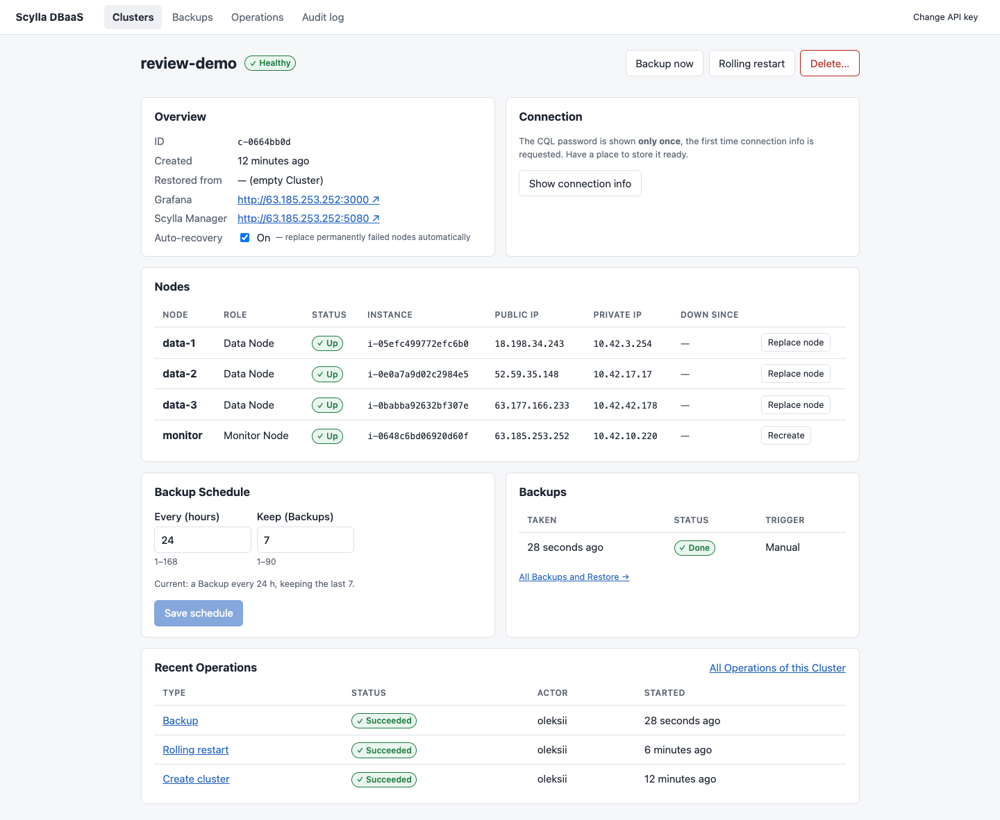
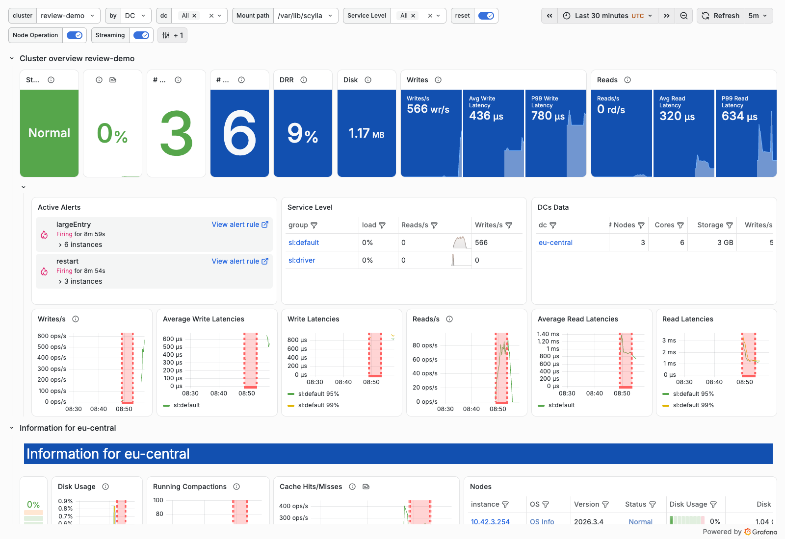

# Scylla DBaaS

A simplified Database-as-a-Service for ScyllaDB on AWS. A user creates and operates a
**Cluster** (3 Data Nodes + 1 Monitor Node running Scylla Manager and the Scylla Monitoring
Stack in Docker, all on Ubuntu 24.04) through a web UI and a REST API.
Assignment brief: [`task.txt`](task.txt).

```
 Operator laptop                     Control Plane (docker-compose, local)          AWS eu-central-1, per Cluster
┌──────────────┐  REST /api/v1   ┌────────────────────────────────────────┐   ┌──────────────────────────────────┐
│ React UI     │ ──────────────▶ │ FastAPI ── API key → Actor ── Audit    │   │ Terraform state (S3)             │
│ curl / SDK   │                 │ Operation runner (1 per Cluster, 409)  │──▶│ 3 × Data Node  i4i.large         │
│ cql-client   │ ──CQL 9042───┐  │ Health checker → Auto-recovery         │   │   ScyllaDB + manager-agent       │
└──────────────┘              │  │ Provider: fake | local | aws           │   │ Monitor Node t3.xlarge (Docker)  │
                              │  │ SQLite: Clusters, Operations, Backups  │   │   Manager, Prometheus, Grafana,  │
                              │  └────────────────────────────────────────┘   │   Loki                           │
                              └─────────────────────────────────────────────▶ │ S3 Backups · Secrets Manager     │
                                                                              └──────────────────────────────────┘
```

## For reviewers — where to find what the brief asks for

| The brief asks for | Where |
|---|---|
| A demoable solution | [Status](#status--what-is-verified-and-what-is-not): the full demo ran on real AWS through the public API; [Running on AWS](#running-on-aws) + [demo script](#demo-script-definition-of-done) to repeat it; `make demo-local` runs it on Docker with no cloud account |
| Architecture and design choices | Diagram above; [`docs/adr/`](docs/adr/) — 6 ADRs (control plane outside AWS, Terraform per Cluster + cloud-init, in-process Operation runner, public subnet + allowlist, Restore into a new Cluster, Provider abstraction); [`infra/README.md`](infra/README.md) for seeds and Node Replacement |
| Trade-offs and prioritization | [Assumptions](#assumptions), [Known limitations](#known-limitations), [What production would do differently](#what-production-would-do-differently); the cut-order agreed before coding is in [`CLAUDE.md`](CLAUDE.md) |
| Prompts, plans, multi-agent instructions | [`docs/ai-process/`](docs/ai-process/): every human prompt verbatim with what it triggered ([`prompts.md`](docs/ai-process/prompts.md)), the planning interview ([`grilling.md`](docs/ai-process/grilling.md)), the chronological log with the human's prompts ([`log.md`](docs/ai-process/log.md)), the instructions given to each parallel agent ([`agents/`](docs/ai-process/agents/)) |
| HTML presentation generated by AI about the plan, quality, missing items | [`docs/ai-process/presentation.html`](docs/ai-process/presentation.html) — download and open in a browser (← → to navigate, N for speaker notes); 15 slides: plan, architecture, behaviour, demo, agents, quality, where the AI was wrong, gaps |
| Quality and missing items | [Status](#status--what-is-verified-and-what-is-not) table (what ran where, what did not); [`docs/ai-process/mistakes.md`](docs/ai-process/mistakes.md) — 19 defects the AI introduced, how each was caught and fixed |
| Bonus: CQL client | [`cql-client/`](cql-client/) — writes, reads and verifies rows over CQL (RF=3, QUORUM); ran against the AWS Cluster |
| Assumptions, decisions, limitations, production differences | Sections below |

Vocabulary: [`GLOSSARY.md`](GLOSSARY.md) — used verbatim in code, API and UI.

## Status — what is verified and what is not

Verified on **8 November 2026** against real AWS (`eu-central-1`) and real ScyllaDB 2026.3.4 /
Scylla Manager 3.13.0 / Scylla Monitoring 4.16.3, driven only through the public API:

| Area | State | Evidence |
|---|---|---|
| Create Cluster on AWS (3 × `i4i.large` + `t3.xlarge`) | ✅ ran | Terraform + cloud-init → `healthy` with no manual step, ~16 min (Restore Cluster: 5 min) |
| CQL client from the operator laptop (bonus) | ✅ ran | 1000 rows written and verified, RF=3 / QUORUM; 0 missing, 0 mismatched |
| Monitoring | ✅ ran | Grafana 13 with 8 Scylla dashboards; Prometheus: 12/12 targets up (scylla, node_exporter, manager_agent ×3, Manager, Grafana, Prometheus) |
| Auto-recovery | ✅ ran | EC2 instance of `data-2` terminated → `degraded` in 6 s → after the 120 s grace `replace_node` by actor `system` → new VM with the **same IP**, new Host ID (`replace_node_first_boot`), Manager repair → `healthy` 7 min after the failure; data readable throughout |
| Backup → delete → Restore | ✅ ran | Manager backup to S3 (1480 objects); source Cluster deleted, Backup kept; Restore into a new Cluster (schema, then data) → all 1000 rows verified |
| Audit | ✅ ran | every step above recorded with Actor (`oleksii` or `system`), action and result |
| Cleanup | ✅ ran | Cluster delete + Backup delete leave 0 instances, EIPs, ENIs, secrets, backup objects |
| `local` Docker driver | ✅ ran | integration test: create → write → Backup → delete → Restore → verify → delete, passes in ~90 s |
| Control Plane, Operations, 409s, restart recovery | ✅ runs | 57 unit/lifecycle tests; ruff + mypy --strict clean |
| UI (6 screens) | ✅ ran on AWS | Cluster list, detail (nodes, Backups, schedule, Operations), Operations, Backups, Audit log against a real AWS Cluster on 9 Nov — [screenshots](docs/screenshots/) |
| CI on GitHub Actions | ✅ green | control-plane, cql-client, ui, terraform, and both Docker images build; the Docker `integration` job and `aws-e2e` are manual (`workflow_dispatch`) |
| Rolling restart | ✅ ran on AWS | drain → restart over SSM → wait UN, one node at a time; the client kept reading (12/12 verifications passed during the restart); Grafana's `restart` alert fired for exactly the 3 nodes |

Getting there took five Cluster creations on AWS and three integration runs on Docker; each
found a bug that mocks and static checks had missed (ten in total, e.g. a seed-list deadlock
under Raft topology, a Manager one-shot task that never starts, a security-group rule missing
for hairpin traffic). All are listed with cause and fix in
[`docs/ai-process/mistakes.md`](docs/ai-process/mistakes.md) (#8–#18).

### Screenshots (real AWS Cluster, 9 November 2026)

| | |
|---|---|
|  |  |
| Cluster detail: 4 EC2 nodes, Backup, Operations | Grafana (Scylla Monitoring): 566 writes/s from `cql-client`; the red band is the rolling restart |

More: [Clusters](docs/screenshots/clusters.png) · [Operations](docs/screenshots/operations.png) · [Backups](docs/screenshots/backups.png) · [Audit log (two days of real history, failures included)](docs/screenshots/audit.png)

## Quickstart (no cloud, no Docker)

Prerequisites: [uv](https://docs.astral.sh/uv/), Node 22.

```bash
make install
make test                 # control-plane + cql-client unit tests
make api-fake             # API on :8000, in-memory fake Provider (1 s per step)
cd ui && cp .env.example .env && npm run dev     # UI on :5173, API key: dev-key
```

API docs: <http://localhost:8000/docs> (header `X-API-Key: dev-key`).

The fake Provider simulates the whole lifecycle, so every UI screen and API call can be
demonstrated without spending money.

## Running locally on Docker (`local` driver)

```bash
make api-local            # terminal 1: Control Plane on the host with DBAAS_PROVIDER=local
make demo-local           # terminal 2: create → write → verify → Backup → Restore → verify → delete
```

Three `scylladb/scylla` containers + a Monitor container set (Manager, Prometheus, Grafana)
per Cluster, plus an S3-compatible object store for Backups. Ports are published on
`127.0.0.1` because container IPs are not reachable from a macOS host.

## Running on AWS

One-time:

```bash
aws configure                                  # or SSO; needs EC2, S3, IAM, Secrets Manager, SSM
cd infra/base && terraform init && terraform apply
```

Then set the Control Plane env (full list in [`infra/README.md`](infra/README.md)), start it
with `DBAAS_PROVIDER=aws`, and use the UI or API. **Always delete Clusters at the end of a
session** — a running Cluster costs roughly $0.8/hour. The `aws-e2e` GitHub workflow does
the same end to end with GitHub OIDC and always destroys what it created.

### Demo script (definition of done)

1. Create a Cluster in the UI → watch the Operation log until **Healthy**.
2. `cql-client --from-api … write 1000` (keyspace `demo`, RF=3, QUORUM).
3. Open Grafana from the Cluster page → Scylla dashboards show the writes.
4. Terminate one Data Node in the AWS console.
5. The Cluster turns **Degraded**; after the 2-minute grace period Auto-recovery runs a Node
   Replacement (same IP, `replace_node_first_boot`, then repair) → **Healthy**.
6. **Backup now**.
7. Delete the Cluster (type its name to confirm). The Backup stays.
8. Backups → **Restore into new Cluster**.
9. `cql-client … verify` → all 1000 rows are back.
10. Audit log shows the whole story, with `system` as the Actor of automatic actions.

## API

Everything the UI does is a public API call. Mutating calls return `202` with an
**Operation** to poll; a second mutating call on the same Cluster returns `409` with
`active_operation_id`.

| Method | Path | |
|---|---|---|
| POST / GET | `/api/v1/clusters` | create (optionally `from_backup_id` = Restore) / list |
| GET / PATCH / DELETE | `/api/v1/clusters/{id}` | details / toggle `auto_recovery` / delete (`?confirm=<name>`) |
| POST | `/api/v1/clusters/{id}/nodes/{node}/replace` | Node Replacement (or Monitor Node recreation) |
| POST | `/api/v1/clusters/{id}/rolling-restart` | |
| GET | `/api/v1/clusters/{id}/connection` | contact points, user, password (only on the first call) |
| GET / PUT | `/api/v1/clusters/{id}/backup-schedule` | |
| POST / GET / DELETE | `/api/v1/clusters/{id}/backups` | Backup now / list / delete all of a Cluster's Backups |
| GET | `/api/v1/backups`, `/api/v1/backups/{id}` | includes Backups of deleted Clusters |
| GET | `/api/v1/operations`, `/api/v1/operations/{id}` | with step log |
| GET | `/api/v1/audit-events?cluster_id=&actor=&action=` | |
| GET | `/metrics`, `/api/v1/healthz` | Prometheus metrics of the Control Plane |

## How the requirements are covered

| Requirement | How |
|---|---|
| Provisioning & lifecycle | Terraform per Cluster driven by Operations; create, delete, rolling restart, Node Replacement |
| Failure recovery | systemd restarts Scylla; the health checker detects dead Data/Monitor Nodes (cloud state + Scylla's own view), Auto-recovery replaces them after a grace period; Auto-recovery pre-empts a running Backup |
| Backup & restore | Scylla Manager → S3, daily schedule (retention 7) + Backup now; scheduled Backups are mirrored into the Control Plane every ~5 min; Restore = new Cluster from a Backup (ADR-0005) |
| Monitoring & observability | Scylla Monitoring Stack (Prometheus, Grafana, Loki with node logs) on the Monitor Node; `/metrics` and JSON logs for the Control Plane |
| Logging & auditing | Append-only Audit Events (actor, action, target, result, request id) incl. denied requests and automatic actions; structured JSON logs with request ids |
| API | FastAPI + OpenAPI; UI types are generated from it |
| CI | `ci.yml`: ruff, mypy --strict, pytest, terraform fmt/validate/tflint/checkov, UI lint/typecheck/build, Docker builds, optional local-driver integration; `aws-e2e.yml` manual |
| Bonus CQL client | `cql-client` write / read / verify, token-aware, QUORUM |

## Assumptions

- One operator, trusted network position; the Control Plane runs on their machine (ADR-0001).
- One Cluster at a time in practice: each Cluster uses 4 Elastic IPs and the default quota
  is 5 per region.
- Cluster size is fixed at 3 Data Nodes (as in the brief); no scaling or version upgrades.
- RF=3 and QUORUM for user data, so one Data Node may be lost without unavailability.
- "Monitor Node lost" counts as **Degraded**: data is fine, Backups and metrics are not.

## Known limitations

- Backups are stored where Scylla Manager puts them: `s3://<bucket>/backup/{meta,schema,sst}/cluster/<manager id>`.
  The API's `location` (`s3:<bucket>/clusters/<id>`) is a logical name; the Manager id is derived
  deterministically from the Cluster id, so the mapping is stable.
- A new AWS account has a 5-vCPU limit for standard instances; one Cluster needs 10, so request
  an increase (16 was approved in minutes). With 16 vCPU and 5 EIPs only one Cluster fits at a
  time, which is why the demo deletes the source Cluster before restoring.
- The CQL password is revealed once by the API; afterwards the operator reads it from Secrets
  Manager (`dbaas/<id>/cql`).
- Clusters are reachable from the operator CIDR over the internet (ADR-0004), including the
  unauthenticated Scylla REST API on port 10000. No TLS for CQL or between nodes.
- One static API key per Actor; no roles.
- Operations run inside the API process: a restart marks running Operations failed instead
  of resuming them (ADR-0003). SQLite is the Control Plane database.
- Data Nodes install the AWS CLI via snap at boot to read their secret: slower boot.
- Backups older than a Cluster's lifetime are deleted only explicitly; Manager's own
  retention governs scheduled snapshots.
- Local driver on macOS: cql-client can use only one contact point (container IPs are not
  routable from the host).

## What production would do differently

| Here | Production |
|---|---|
| Control Plane on a laptop, SQLite | HA service in its own account/VPC, Postgres (RDS), migrations |
| In-process asyncio Operation runner | Durable workflows (Temporal / Step Functions) with retries and resumption |
| Public subnet + IP allowlist | Private subnets, PrivateLink / VPC peering to customer networks, no public IPs |
| No TLS | Client-to-node and node-to-node TLS, certificate rotation |
| API key → Actor | OIDC, RBAC, per-tenant isolation and quotas |
| cloud-init installs packages at boot | Packer-baked AMIs, immutable nodes, faster Node Replacement |
| One Monitor Node per Cluster | Shared, multi-tenant observability backend; alerts routed to on-call |
| Fixed 3 nodes | Scale out/in, rolling upgrades, multi-AZ placement guarantees, multi-DC |
| Audit table in SQLite | Tamper-evident audit log shipped off-host, plus CloudTrail |

## Repository layout

| Path | What |
|---|---|
| `control-plane/` | FastAPI API, Operation runner, health checker, Provider drivers (`fake`, `local`, `aws`), Scylla/Manager clients |
| `infra/` | Terraform `base` stack, per-Cluster `cluster` module, cloud-init |
| `ui/` | React + Vite SPA on the public `/api/v1` |
| `cql-client/` | `cql-client` CLI (bonus) and the `dbaas-e2e` scenario runner |
| `deploy/local/` | Assets for the local Docker driver |
| `.github/workflows/` | `ci.yml` (every PR), `aws-e2e.yml` (manual, GitHub OIDC) |
| `docs/adr/`, `GLOSSARY.md` | Decisions and vocabulary |
| `docs/ai-process/` | Grilling transcript, agent instructions, log, AI mistakes |
